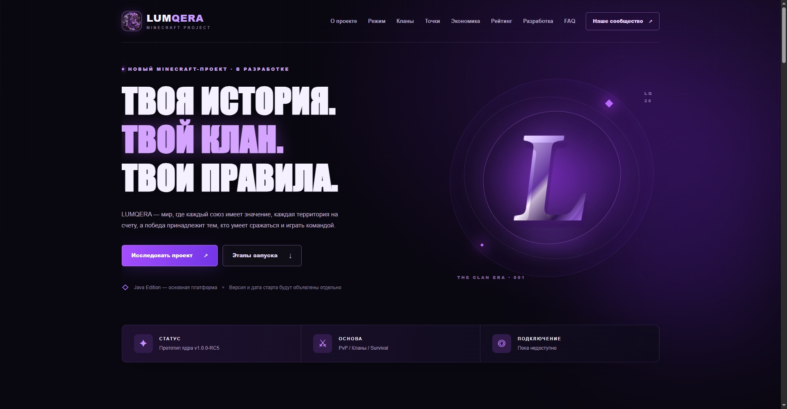

<p align="center">
  
</p>

<h1 align="center">LUMQERA</h1>

<p align="center">
  <strong>Твой мир. Твой клан. Твои правила.</strong><br>
  Minecraft-проект с акцентом на честное PvP, развитие кланов и борьбу за территории.
</p>

<p align="center">
  <a href="https://github.com/Zeihos/LUMQERA/actions/workflows/build.yml"></a>
  
  
  
</p>

<p align="center">
  <a href="https://lumqera.ru">Сайт проекта</a> &nbsp;·&nbsp;
  <a href="https://github.com/Zeihos/LUMQERA/actions/workflows/build.yml">Скачать сборку</a> &nbsp;·&nbsp;
  <a href="https://github.com/Zeihos/LUMQERA/issues/new/choose">Сообщить об ошибке</a> &nbsp;·&nbsp;
  <a href="#быстрый-старт">Быстрый старт</a>
</p>

---

## О проекте

**LUMQERA** — разрабатываемый PvP/Survival-сервер для Minecraft Java Edition. В основе — кланы, командное противостояние, экономика и территории, которые действительно нужно защищать.

Проект включает собственный игровой плагин **LumqeraCore** и веб-сайт. Мы не выдаём незавершённые механики за готовый релиз: код ядра собирается в GitHub Actions, но полноценная проверка всех систем в работающем Minecraft-сервере ещё впереди.

> [!IMPORTANT]
> **Статус: разработка · RC13.** Публичный запуск сервера, адрес для подключения и дата релиза пока не объявлены. Исходники в этом репозитории — не обещание доступного игрового сервера.

## Возможности

| Направление | Что реализовано в исходниках |
| :-- | :-- |
| **PvP** | Статистика убийств и смертей, рейтинг, антифарм, ограничения во время боя |
| **Кланы** | Создание, приглашения, роли, развитие и клановое влияние |
| **Территории** | Приват чанков, защита построек и безопасные зоны |
| **Клановые войны** | Вызовы, активные войны, очки и результаты |
| **Контрольные точки** | Захват аванпостов и награды за удержание |
| **Экономика** | Игровые монеты, переводы, клановая казна и магазин |
| **Взаимодействие** | Обмен предметами, перемещение на спавн, клановые дома |
| **Модерация** | Жалобы игроков, служебные заметки и предупреждения |
| **Сайт** | Описание проекта, разделы механик и отображение публичной статистики |

<details>
<summary><b>Основные игровые команды</b></summary>

| Команда | Назначение |
| :-- | :-- |
| `/clan` | Клан и управление участниками |
| `/claim`, `/unclaim` | Приват и освобождение чанка |
| `/pvpstats`, `/top` | PvP-статистика и рейтинги |
| `/war`, `/outpost` | Клановые войны и точки захвата |
| `/balance`, `/pay` | Баланс и переводы |
| `/treasury`, `/shop` | Казна и магазин |
| `/trade`, `/menu` | Обмен и игровое меню |
| `/report` | Жалоба администрации |
| `/spawn` | Телепортация на спавн |
| `/lumqera` | Служебная информация и управление ядром |

Доступность некоторых команд зависит от прав игрока и серверной конфигурации.

</details>

## Визуальный стиль

Проект использует тёмную фиолетовую палитру, контрастные акценты и собственное оформление. Исходные материалы для сообщества хранятся в [`assets/`](assets), а веб-интерфейс — в [`website/`](website).

<details>
<summary><b>Посмотреть скриншот сайта</b></summary>

<br>



<sub>Скриншот одной из ранних итераций сайта (RC5); текущая версия может отличаться.</sub>

</details>

## Быстрый старт

**Потребуется:** Windows или Linux, **JDK 25**, **Gradle 9.1.0** и **Paper 26.3**. Сайт локально запускается через Node.js.

### 1. Собрать ядро

**Windows:** запустите из корня репозитория `build-plugin-windows.bat`. При отсутствии Gradle скрипт предложит скачать его в локальную папку без прав администратора.

**Терминал:**

```bash
cd server/LumqeraCore
gradle clean build --no-daemon
```

После успешной сборки появится:

```text
server/LumqeraCore/build/libs/LumqeraCore-1.0.0-RC13.jar
```

**Без локальной сборки:** перейдите в [GitHub Actions](https://github.com/Zeihos/LUMQERA/actions/workflows/build.yml), откройте успешный запуск и скачайте JAR из блока **Artifacts**.

### 2. Запустить Paper

1. Скачайте **Paper для Minecraft 26.3** с [официального сайта](https://papermc.io/downloads/paper) и сохраните как `server/paper/paper.jar`.
2. Запустите сервер один раз, чтобы получить первоначальные настройки. Пример — [`server.properties.example`](server/paper/server.properties.example).
3. **Полностью остановите сервер** командой `stop`, затем запустите `deploy-plugin-windows.bat` или вручную поместите собранный JAR в `server/paper/plugins/`.
4. Прочитайте [Minecraft EULA](https://aka.ms/MinecraftEULA). Только при согласии вручную установите `eula=true` в созданном `eula.txt`.
5. Запустите `start-server-windows.bat` и проверьте появление `LumqeraCore` в команде `plugins`.

Для закрытых тестов рекомендуется оставить `online-mode=true` и включить белый список.

### 3. Посмотреть сайт

На Windows запустите `start-website-windows.bat` при установленном Node.js. Либо из корня репозитория выполните:

```bash
node website/dev-server.mjs
```

Локальный адрес: **http://127.0.0.1:3000**.

Публичная статистика экспортируется ядром и переносится в `website/data/public-stats.json` через `sync-rating-windows.bat`. Без свежего экспорта отображается исходный JSON со статусом разработки и пустыми списками.

## Структура репозитория

```text
LUMQERA/
├── assets/                   Оформление и материалы сообщества
├── docs/                     Скриншоты проекта
├── server/
│   ├── LumqeraCore/          Java-плагин, конфигурация и тесты
│   └── paper/                Пример настройки Paper
├── website/                  Фронтенд и локальный веб-сервер
├── .github/                  CI и шаблоны обращений
└── *.bat / *.ps1             Windows-сборка, запуск и резервирование
```

Исходники и серверные данные разделены: **игровые миры, журналы, данные игроков и собранные JAR не должны попадать в публичные коммиты**.

## История обновлений

Что меняется между версиями и как развиваются механики — в [CHANGELOG.md](CHANGELOG.md).

## Закрытое тестирование

Для защиты построек используйте [чек-лист RC12](docs/TESTING-RC12.md): PvP, поршни, жидкости, воронки и взрывы. Для новой системы надёжности кланов — [тест-план RC13](docs/TESTING-RC13.md).

**Сохранность данных RC13:** операции кланов подтверждаются только после сохранения. Испытания на работающем Paper и проверка сценариев роспуска с другими системами ещё обязательны. [История изменений](CHANGELOG.md).

## Этапы разработки

- [x] Базовые системы кланов, PvP, экономики и территорий реализованы в коде
- [x] Организована сборка и автоматические тесты на Windows и Linux
- [x] Упорядочены структура репозитория и оформление проекта
- [ ] Проверить все игровые механики на реальном Paper-сервере
- [ ] Провести закрытое тестирование с несколькими игроками и настройку баланса
- [ ] Подготовить инфраструктуру и объявить публичный релиз

## Участие в разработке

Подробные правила для сообщений об ошибках и изменений — в [CONTRIBUTING.md](CONTRIBUTING.md). Проверка сайта находится в `tests/website-smoke.test.mjs`.

## Обратная связь

Нашли ошибку или хотите предложить улучшение? Используйте раздел [**Issues**](https://github.com/Zeihos/LUMQERA/issues/new/choose) — там доступны русскоязычные шаблоны.

Если прикладываете логи, **удалите токены, личные данные игроков, приватные IP-адреса и другую чувствительную информацию**.

---

<p align="center">
  <br>
  <b>LUMQERA</b> · Minecraft PvP &amp; Clans<br>
  <sub>Разработка продолжается · LumqeraCore 1.0.0-RC13</sub>
</p>
